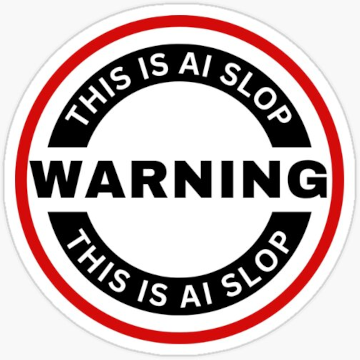

# Noughts and Crosses — Qt 6 Linux Desktop Port

**⚠️ WORK IN PROGRESS — This port is under development and contains bugs and incomplete features.**

A modern Linux desktop port of the classic 1993–1994 Windows 3.x game **Noughts and Crosses** by Pentti Moilanen (GPL v2+).

## About the game

Noughts and Crosses is a connect-N strategy game (tic-tac-toe / Gomoku style). Players place noughts (O) or crosses (X) on a board and try to form a row of five (configurable to 1–9) before the opponent. The game includes:

* Computer opponent with six skill levels (Beginner → Master)
* Choose your piece (Noughts / Crosses)
* Choose who starts (User / Computer / Alternating / Random)
* Configurable rows-to-win (1–9)
* Zoom in / zoom out, center view, and scrolling for large boards
* Undo and Hint (Cheat menu)
* Flashing animation for winning rows
* Statistics (wins / losses / win percentage)
* Settings saved automatically between sessions

## Build requirements

* Qt 6 (Core, Widgets, GUI) — `qt6-base-dev` on Debian/Ubuntu
* A C++17 compiler (`g++`)
* `make`

Qt is located at `/usr/lib/qt6/` on this system.

## Build and run

```bash
cd /home/tux/0x

# Generate the Makefile with Qt 6 qmake
/usr/lib/qt6/bin/qmake6 noughtsandcrosses.pro

# Build
make -j$(nproc)

# Run
./noughtsandcrosses
```

## Project layout

```
board.h / board.cpp       Game engine & AI (ported from original C sources)
gamewidget.h / gamewidget.cpp   Board view & painting
mainwindow.h / mainwindow.cpp   Main window, menus & status bar
computerworker.h / computerworker.cpp   Background AI thread
aboutdialog.h / aboutdialog.cpp   About dialog
statisticsdialog.h / statisticsdialog.cpp   Statistics dialog
main.cpp                  Application entry point
noughtsandcrosses.pro     Qt qmake project file
CMakeLists.txt            CMake alternative
```

## Controls

| Action | Key / Menu |
|--------|-----------|
| Place piece | Click on an empty square |
| New game | Game → New (F2) |
| Exit | Game → Exit (Ctrl+Q) |
| Statistics | Game → Statistics |
| Skill level | Skill → Beginner / Novice / Expert / Master |
| Your piece | Options → User's piece → Noughts / Crosses |
| Who starts | Options → Who begins |
| Rows to win | Options → Rows of five (1–9) |
| Background processing | Options → Background processing |
| Undo | Cheat → Undo |
| Hint | Cheat → Hint |
| Zoom in | View → Zoom In (Ctrl+I) |
| Zoom out | View → Zoom Out (Ctrl+O) |
| Center board | View → Center |
| Computer's last | View → Computers last |
| About | Help → About Noughts and Crosses |
| Minimize | Escape |

## License

Original code: Copyright © 1993–1994 Pentti Moilanen, licensed under the GNU General Public License v2 or later. See `COPYING`.

This Qt port is distributed under the same GPL v2+ terms.
